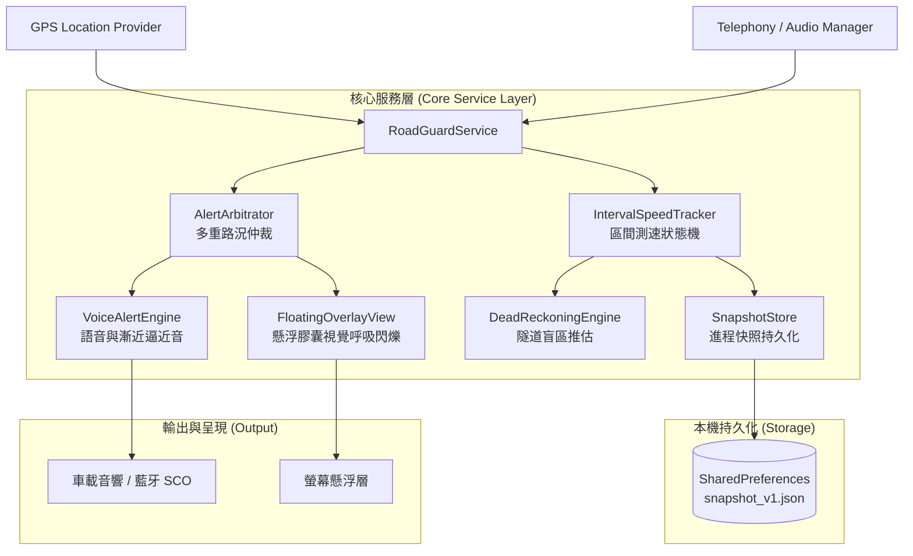
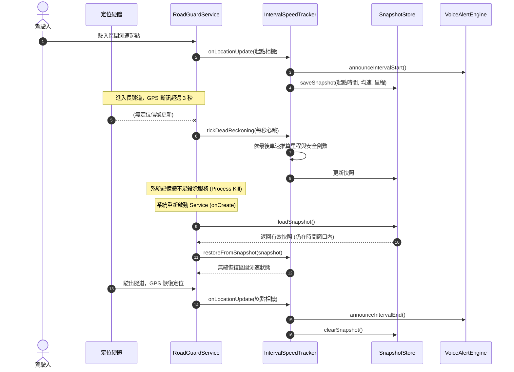

# 系統架構設計規格書 (doc/high-level-design.md)

## 1. 系統架構總覽 (Architecture Overview)

本專案採用 **服務驅動 (Service-Driven) 與狀態機解耦** 之架構。本次迭代重點為對標《神盾測速照相》，在 `RoadGuardService` 下建構三大關鍵子系統：
1. **區間測速推估與狀態持久化子系統** (`DeadReckoningEngine` + `SnapshotStore`)
2. **多事件優先級仲裁引擎** (`AlertArbitrator`)
3. **情境感知語音與逼近音調度器** (`VoiceAlertEngine` + `AudioPolicy`)

---

## 2. 模組劃分與職責邊界 (Module Responsibilities)

### 2.1 `IntervalSpeedTracker` 與 `DeadReckoningEngine`
- **職責**: 追蹤區間測速完整生命週期，包含進出起終點判定、累積里程均速計算。
- **推估子模組**: 當 `isGpsValid == false` 超過 3 秒，自動轉入 `DeadReckoning` 狀態；每秒模擬車行推移 $\Delta D = V_{last} \times \Delta t$，計算預計安全通行秒數與估計均速。
- **邊界限制**: 單向資料流，只接收坐標與車速訊號，不直接調用 Android UI 或 TTS。

### 2.2 `IntervalSnapshotStore` (進程崩潰復原)
- **職責**: 負責在區間狀態變更時，將記憶體狀態原子化序列化至 `SharedPreferences`。
- **重啟策略**: 在 `RoadGuardService.onCreate()` 啟動時自動載入：
  - 若 $T_{now} - T_{entry} < T_{max\_window}$（通行窗口內），立即還原區間工作階段。
  - 若已超時或資料毀損，清空快照並安全回退至巡航狀態。

### 2.3 `AlertArbitrator` (超速優先仲裁器)
- **職責**: 接收多個併發路況（固定相機、科技執法、區間終點、道路施工），輸出單一決定性之警報動作。
- **仲裁矩陣**:
  1. `isOverspeed == true`：強制發出最高優先級 `EMERGENCY_OVERSPEED`，Flush 語音佇列並播放緊急音效。
  2. `isOverspeed == false`：若相機與施工重疊，生成語意融合字串（Alert Fusion），按單一語音完整播報。

### 2.4 `VoiceAlertEngine` (通話焦點與漸近逼近音)
- **職責**: 語音 TTS 播報、音訊焦點 (Audio Focus) 請求與釋放、逼近音頻率階梯調度。
- **通話處理策略**:
  - `MODE_MUTE_VISUAL` (預設)：偵測到通話中時，TTS 靜音，通知 `FloatingOverlayView` 執行紅黃雙色視覺呼吸閃爍。
  - `MODE_DUCKING`：請求 `AUDIOFOCUS_GAIN_TRANSIENT_MAY_DUCK`，降低通話音量後播報。
  - `MODE_NORMAL`：標準音量播報。
- **逼近音階梯**:
  - 150m ~ 100m: 1.0s 間隔短音
  - 100m ~ 50m: 0.5s 間隔短音
  - 50m ~ 0m: 0.25s 間隔急促音（超速時升級為警報音）

### 2.5 `FloatingOverlayView` (動態視覺回饋)
- **職責**: 螢幕懸浮視窗渲染。
- **擴充功能**:
  - 支援「盲區推估中」狀態圖示與估算時速/倒數展示。
  - 支援「通話中靜音警報」之邊框呼吸閃爍特效。

---

## 3. 核心時序流程 (Sequence Diagrams)

### 3.1 進入隧道斷訊之死角推估與重啟復原時序

---

## 4. 模組改動範圍與檔案邊界 (Allowed Files Policy)

根據鐵律 2「最小改動原則」，本架構嚴格限制改動與新建檔案如下：

| 模組分類 | 檔案路徑 | 改動屬性 |
| :--- | :--- | :--- |
| **區間測速與推估** | `app/src/main/java/tw/roadguard/aegis/service/IntervalSpeedTracker.kt` | 修改 (擴充推估與持久化) |
| **警報仲裁** | `app/src/main/java/tw/roadguard/aegis/service/AlertArbitrator.kt` | 新建 (純邏輯仲裁引擎) |
| **語音與通話** | `app/src/main/java/tw/roadguard/aegis/service/VoiceAlertEngine.kt` | 修改 (通話偵測與逼近音) |
| **懸浮窗展示** | `app/src/main/java/tw/roadguard/aegis/service/FloatingOverlayView.kt` | 修改 (閃爍與推估標記) |
| **背景服務協調** | `app/src/main/java/tw/roadguard/aegis/service/RoadGuardService.kt` | 修改 (生命週期接線與復原) |
| **商店上架合規文檔** | `doc/privacy-policy.html` `doc/store-listing.md` | 新建 (法規合規產出物) |
| **測試驗證檔案** | `tests/test_interval_dead_reckoning.py` `tests/test_arbitration.py` `tests/test_parity.py` | 維護與執行 |
